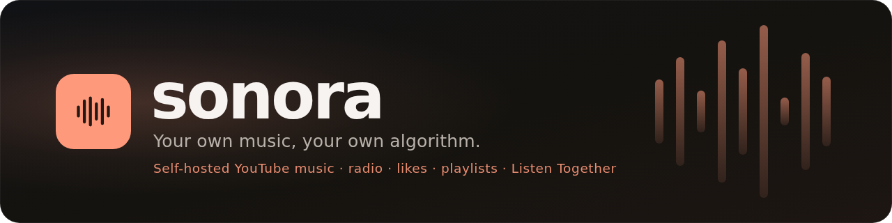

<div align="center">
  
</div>

<div align="center">

**A self-hosted YouTube music app for your phone, desktop and browser.**
Search, endless radio, likes, playlists, an installable offline PWA, and shared listening rooms —
with your own account, your own database, and no algorithm you cannot see.

[](https://nodejs.org)
[](#quick-start)
[](#license)
[](#features)

[Features](#features) · [Quick start](#quick-start) · [Configuration](#configuration) ·
[How it works](#how-it-works) · [Testing](#testing) · [Documentation](#documentation)

</div>

> **Naming.** The product, npm package, container image and every environment variable are all
> `sonora` / `SONORA_*`. This repository directory is still named `muse-pwa`, and two paths on an
> existing install (`data/muse.db`, `~/.local/share/muse-venv`) are detected for compatibility.
> See [Migrating from Muse](#migrating-from-muse) if you are upgrading.

---

## Features

**Listen**

- Search songs, albums, artists and playlists in one request, with type tabs that switch over the
  answer already on screen (no refetch).
- Endless radio and a station that mixes four lanes (familiar, adjacent, discovery, recent) from
  what you actually play — no external recommendation service.
- A queue you can actually edit: drag or Alt+↑/↓ to reorder (the playing song stays the playing
  song), and “Add to queue” from any track menu next to “Play next”.
- Likes, dislikes, playlists, listening history and per-track stats.
- **Follow an artist** and hear about their new releases in the notification bell — or as a
  desktop / PWA notification if you turn that on. The first check only records what already
  exists, so following a band with twelve albums does not fire twelve alerts.
- Synced now-playing across your devices, plus lock-screen / Media Session controls.
- Audio is cached on disk, so seeking is instant and a replay costs no network.

**Share**

- **Listen Together** rooms: one shared playhead, several people following the same track at the
  same position, within a few hundred milliseconds.
- Public rooms can be joined by link **without an account**; private rooms are invite-only.
- Shareable links for tracks (`/t/<id>`) and rooms (`/l/<code>`) with real Open Graph cards.

**Own**

- Accounts stored locally in SQLite — passphrase plus optional **passkeys**, remembered devices
  with rotating refresh tokens, and per-device revocation.
- Installable PWA with an offline app shell.
- Admin panel for users, storage, the YouTube cookie jar and backups.
- No cloud dependency, no build step, no third-party analytics.

## Quick start

There are two ways to run it. The container is the recommended path: it ships everything `yt-dlp`
needs (ffmpeg, a JS runtime, the PO-token plugin).

### Option A — container (recommended)

```bash
git clone https://github.com/<you>/muse-pwa.git
cd muse-pwa

cp .env.example .env
# Edit .env and set the two required values:
#   SONORA_SECRET      (required)    -> the output of:  openssl rand -hex 32
#   SONORA_PASSPHRASE  (first run)   -> a passphrase you will remember
# SONORA_USER (default `toil`) is the name of that first account.
# Every other variable is optional and has a working default.

podman compose up -d --build     # or: docker compose up -d --build
podman compose logs -f
```

Open **http://127.0.0.1:8130** and sign in with the `SONORA_USER` / `SONORA_PASSPHRASE` you set.
The first account is created only while the database has no users, and is an admin.

```bash
podman compose down              # stop; data stays in ./data
podman compose up -d             # start again without rebuilding
```

`./data` holds the SQLite database, the audio cache and the imported YouTube cookie jar. It is
bind-mounted, so the container and a local dev server share the same state — just never run both
at once (SQLite is the reason).

> `SONORA_SECRET` is mandatory in a container. The app deliberately falls back to a random
> per-process key when it is unset (right for a laptop, wrong for a container: every restart would
> sign all devices out and lose the key that encrypts the stored YouTube cookie jar). The
> entrypoint refuses to start with an empty value.

### Option B — local development

Requirements: **Node.js ≥ 22.5** (the app uses the built-in `node:sqlite`), **yt-dlp**, and
**ffmpeg**. A JS runtime for `yt-dlp` (Deno or Node) is recommended.

```bash
npm ci
SONORA_SECRET=$(openssl rand -hex 32) \
SONORA_PASSPHRASE='choose-a-passphrase' \
  npm start                      # http://127.0.0.1:8130
```

Useful scripts:

| Command | What it does |
| --- | --- |
| `npm start` | Run the server (data in `./data`) |
| `npm run dev` | Same, with `--watch` |
| `npm test` | Full suite (needs network + a browser — see [Testing](#testing)) |
| `npm run test:parallel` | Same suite without `--test-concurrency=1` |
| `npm run admin -- list` | List accounts, roles and status |
| `npm run admin -- promote <name>` | Grant admin (also `demote`, `disable`, `enable`) |

## Configuration

Everything is configured through environment variables. All of them are documented in
[`.env.example`](.env.example), which is the single source of truth. Copy it to `.env` and edit.

**In short: set `SONORA_SECRET` for any real deployment, and `SONORA_PASSPHRASE` once to create the
first account. Every other variable is optional.** The **Need** column says which is which.

| Need | Meaning |
| --- | --- |
| **Required** | No safe default. The container refuses to start without it; outside a container the app falls back to a random value that breaks on restart. |
| **First run** | Only needed while the database has no users. Ignored once an account exists. |
| **Conditional** | Has a default that is wrong for one specific setup (a proxy, a tunnel, a feature). Set it only when that applies. |
| **Optional** | Has a working default. Change it only if you want different behaviour. |

### Essential

| Variable | Need | Default | Purpose |
| --- | --- | --- | --- |
| `SONORA_SECRET` | **Required** in a container; optional in dev | random per process | Signs session cookies **and** derives the AES key for an imported YouTube cookie jar. Set it explicitly in production. |
| `SONORA_PASSPHRASE` | **First run** | — | Passphrase for the bootstrap account. Only used while the users table is empty. |
| `SONORA_USER` | Optional | `toil` | Name of the bootstrap account. Set this explicitly for a new instance. |
| `PORT` | Optional | `8130` | HTTP port. |
| `HOST` | Optional | `127.0.0.1` | Bind address. Containers set `0.0.0.0`. |
| `SONORA_BIND` | Optional | `127.0.0.1` | Host address the compose file publishes on. Use `0.0.0.0` for LAN access. |

### Storage and performance

| Variable | Need | Default | Purpose |
| --- | --- | --- | --- |
| `SONORA_DB` | Optional | `./data/sonora.db` | SQLite database path. |
| `SONORA_AUDIO_DIR` | Optional | `./data/audio` | Downloaded-audio cache directory. |
| `SONORA_CACHE_MB` | Optional | `8192` | Cache ceiling in MB. |
| `SONORA_MAX_DOWNLOADS` | Optional | `4` | Concurrent `yt-dlp` downloads. |
| `SONORA_DOWNLOAD_TIMEOUT_MS` | Optional | `120000` | Download safety ceiling. |
| `SONORA_LOG_LEVEL` | Optional | `info` | Fastify log level (`warn` is quieter). |

### Sessions, auth and rooms

| Variable | Need | Default | Purpose |
| --- | --- | --- | --- |
| `SONORA_SESSION_MINUTES` | Optional | `720` | Access-token lifetime. Remembered devices renew silently. |
| `SONORA_REFRESH_DAYS` | Optional | `30` | Lifetime of a "remember this device" refresh token. |
| `SONORA_SESSION_DAYS` | Optional | `90` | Legacy alias, kept so older deployments keep working. |
| `SONORA_LOGIN_RATE_MAX` | Optional | `10` | Sign-in attempts per window, per client. |
| `SONORA_LOGIN_RATE_WINDOW` | Optional | `1 minute` | Rate-limit window. |
| `SONORA_TRUST_PROXY` | Optional | `1` | Trust `X-Forwarded-*` from a tunnel/proxy (needed for correct client IPs). |
| `SONORA_ROOM_HOURS` | Optional | `12` | Idle hours before an empty room is deleted. |
| `SONORA_ROOM_MAX_MEMBERS` | Optional | `50` | Member cap per room. |

### Passkeys and public URLs

A passkey is bound to a **registrable domain**, not an IP. These default to the request's `Host`
header, which is correct for `http://localhost:8130` and a direct HTTPS proxy. Set them when a
tunnel rewrites `Host`, or when the public origin differs from what the process sees.

| Variable | Need | Default | Purpose |
| --- | --- | --- | --- |
| `SONORA_RP_ID` | Conditional | request host | WebAuthn Relying Party ID, e.g. `music.example.com`. Required for passkeys behind a tunnel. |
| `SONORA_ORIGIN` | Conditional | request origin | WebAuthn origin, e.g. `https://music.example.com`. Required for passkeys behind a tunnel. |
| `SONORA_RP_NAME` | Optional | `sonora` | Name shown by the passkey prompt. |
| `SONORA_PUBLIC_URL` | Conditional | request host | Absolute origin used in share cards (`og:url`, `og:image`, oEmbed). Required behind a proxy that rewrites `Host`. |

### YouTube fetching

The defaults work on a clean host. These knobs exist because YouTube intermittently gates whole
IPs behind *"Sign in to confirm you're not a bot"*. None is required to run.

| Variable | Need | Default | Purpose |
| --- | --- | --- | --- |
| `SONORA_YTDLP` | Optional | autodetected | Path to the `yt-dlp` binary. |
| `SONORA_YTDLP_PROXY` | Optional | — | Proxy for `yt-dlp` (`http://…` or `socks5://…`). The only mitigation that changes your IP. |
| `SONORA_YTDLP_COOKIES` | Optional | — | Path to a `cookies.txt` for `yt-dlp`. |
| `SONORA_YT_COOKIE` | Optional | — | Raw `Cookie:` header used by `youtubei.js` for metadata. |
| `SONORA_POT_PROVIDER` | Optional | `http://127.0.0.1:4416` | `bgutil` PO-token provider endpoint; empty disables it. |
| `SONORA_JS_RUNTIME` | Optional | autodetected Deno | JS runtime for `yt-dlp` (`node:/usr/local/bin/node`, `deno:/path`). |
| `SONORA_URL_TTL_MS` | Optional | `10800000` (3 h) | Stream URL cache lifetime. |
| `SONORA_RESOLVE_TIMEOUT_MS` | Optional | `25000` | Metadata request timeout. |

### Container-only (compose)

| Variable | Need | Default | Purpose |
| --- | --- | --- | --- |
| `SONORA_DNS_1` / `SONORA_DNS_2` | Optional | `1.1.1.1` / `8.8.8.8` | Resolvers passed to the container. Rootless podman's own forwarder can be very slow; point these at a fast resolver. |

### Test-only

| Variable | Need | Default | Purpose |
| --- | --- | --- | --- |
| `CHROME_BIN` | Optional | autodetected | Chromium binary for the browser-based UI tests. |

## How it works

```
Browser / installed PWA
        │  same-origin fetch + <audio>
        ▼
Fastify (src/server.js) ──► SQLite (node:sqlite, ./data/sonora.db)
        │                        users, devices, tracks, plays, likes, playlists, rooms,
        │                        artist follows, release baselines, notifications
        ├──► youtubei.js ──► YouTube Music metadata (search, album, artist, lyrics)
        ├──► yt-dlp ──────► complete audio file ──► ./data/audio/<id>.m4a
        └──► GET /api/stream/:videoId ──► ranged reads from the cache
```

Three measured constraints shaped the design, and each is explained in [`PLAN.md`](PLAN.md):

1. **googlevideo URLs are IP-bound and expire.** The phone cannot play a URL the server resolved,
   so every byte goes through `GET /api/stream/:videoId`.
2. **googlevideo serves only the first ~1 MiB to a naive range request.** A transparent byte proxy
   stalls one megabyte into every song. So the server downloads the whole file once, then serves
   ranges off disk. Seeking becomes instant and replay is free.
3. **iOS closes the audio session when a track ends naturally.** The player loops the element and
   switches tracks inside the event, so background playback survives.

There is **no build step**. `public/` is served as-is, which is what makes an offline cache and a
single-document offline shell practical.

## Testing

```bash
npm ci
npm test          # full suite
```

The full suite is intentionally end-to-end: several tests **hit live YouTube**, and the UI,
layout, safe-area, passkey and room tests drive a **real Chromium**. They are therefore
network-dependent and slower (~40 s on a warm cache). Install Chromium or set `CHROME_BIN`; tests
that need a browser skip cleanly when none is found.

For a fast, fully offline check (the same thing CI runs):

```bash
node --no-warnings --test --test-concurrency=1 test/db.test.js test/search-rank.test.js
```

## Project layout

```
src/            server, routes, database, YouTube client, audio cache, rooms
public/         the entire client (HTML/CSS/JS, service worker, icons) — no build step
scripts/        admin CLI, container entrypoint, healthcheck, icon generator
test/           unit, integration, browser and end-to-end tests
docs/           design records: UI, UX, auth and rooms
Containerfile   production image (Node + yt-dlp + ffmpeg + PO-token plugin)
compose.yaml    single-service stack; publishes 127.0.0.1:8130 and mounts ./data
```

## Deployment notes

### Migrating from Muse

The rename was mechanical, but three things live outside the source tree:

1. **Environment variables.** Rename the keys in `.env` and keep the values — especially
   `MUSE_SECRET` → `SONORA_SECRET`, which derives the key that encrypts the stored YouTube cookie
   jar. On Linux:

   ```bash
   sed -i 's/^MUSE_/SONORA_/' .env
   ```

2. **The database file.** New installs use `data/sonora.db`. An existing `data/muse.db` is still
   detected and used automatically, so nothing breaks if you do nothing. To finish the rename,
   stop the server first and move the file (plus its `-wal` and `-shm` siblings):

   ```bash
   podman compose down
   mv data/muse.db data/sonora.db
   ```

3. **The container.** The image and container are now `localhost/sonora:latest` and `sonora`.
   An old `muse` container still holds port 8130, so remove it before starting the new one:

   ```bash
   podman rm -f muse
   podman compose up -d --build
   ```

Two consequences are expected and one-time: session and passkey cookies were renamed, so every
**device is signed out once**, and the cookie-jar key salt changed, so a previously imported
YouTube cookie jar is discarded and must be re-imported (Admin → YouTube). The yt-dlp venv at
`~/.local/share/muse-venv` continues to be detected, so there is nothing to reinstall.

- **Ports and origin.** The dev server and the container both use `8130` on purpose, so bookmarks,
  the installed PWA and a tunnel configuration keep working unchanged.
- **HTTPS is required for passkeys and service workers.** Put the app behind a TLS proxy or a
  tunnel (the author runs Cloudflare Tunnel). Set `SONORA_RP_ID`, `SONORA_ORIGIN` and
  `SONORA_PUBLIC_URL` to the public origin when the proxy rewrites `Host`.
- **Persist `./data`.** It contains the database and the audio cache. Back it up through
  *Admin → Storage → Backup* or by copying the file while the server is stopped.
- **Keep `SONORA_SECRET` stable.** Rotating it invalidates every session and makes the encrypted
  YouTube cookie jar unreadable (you will need to re-import cookies).
- **Do not run the container and `npm start` against the same `./data` at the same time.**

## Security notes

- All state is local. There is no telemetry and no third-party service beyond YouTube itself.
- Session cookies are `HttpOnly`, signed, and `Secure` outside dev. Refresh tokens rotate on use;
  replaying an old one revokes the device. Passkeys are optional and revocable per device.
- The imported YouTube cookie jar is encrypted at rest with a key derived from `SONORA_SECRET` and is
  never sent back to a client.
- Public listening rooms use a separate, room-scoped guest cookie so "anyone with the link" cannot
  become "anyone can proxy any video". The boundary is covered by tests.
- **Never commit `.env`, `data/`, or any `cookies.txt`.** They are in `.gitignore`; keep it that
  way.

## Documentation

| Document | Contents |
| --- | --- |
| [`docs/ui.md`](docs/ui.md) | Interface structure, design tokens, layout and playback behaviour |
| [`docs/ux-spec.md`](docs/ux-spec.md) | The production-polish contract the UI was built against |
| [`docs/auth.md`](docs/auth.md) | Credentials, sessions, devices and passkeys |
| [`docs/rooms.md`](docs/rooms.md) | Listen Together: database, wire format, sync algorithm, limits |
| [`PLAN.md`](PLAN.md) | The engineering plan and the measurements behind the design |
| [`.env.example`](.env.example) | Every environment variable, with explanations |

## Legal

sonora is a personal, self-hosted client for content you are entitled to access. It is not
affiliated with YouTube or Google. Respect the terms of service of any service you point it at,
and use it for personal listening only.

## License

[MIT](LICENSE) © the sonora authors.
